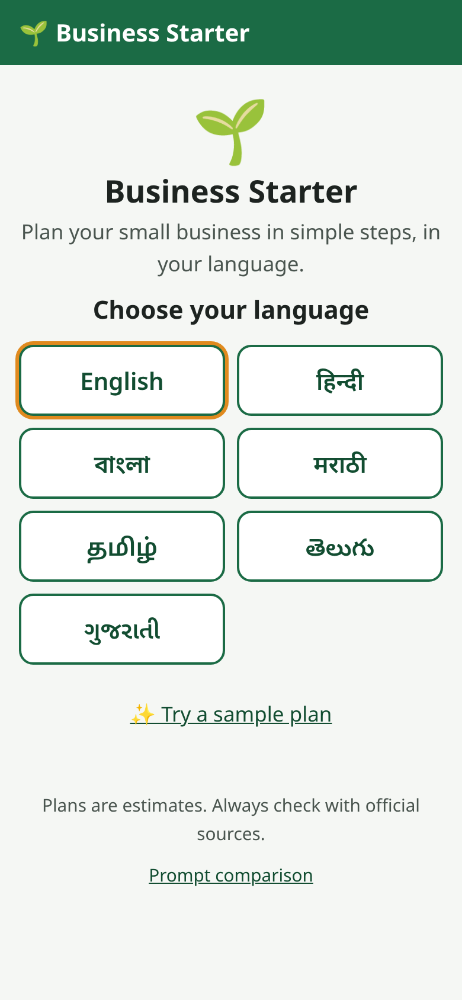
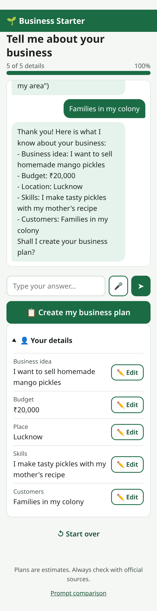
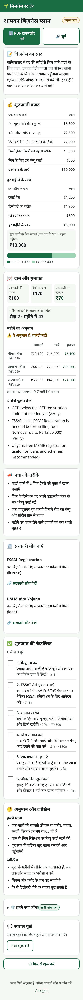
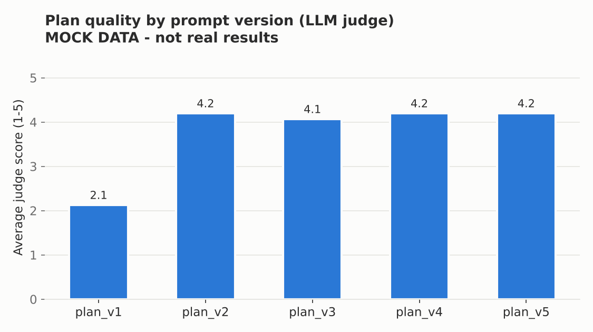
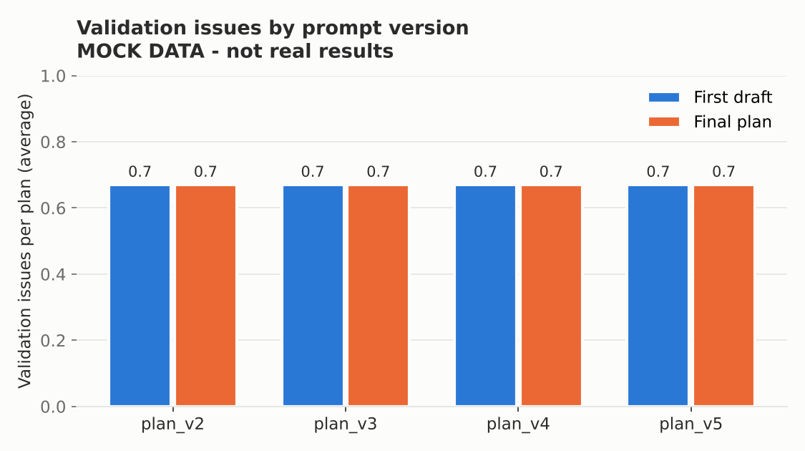
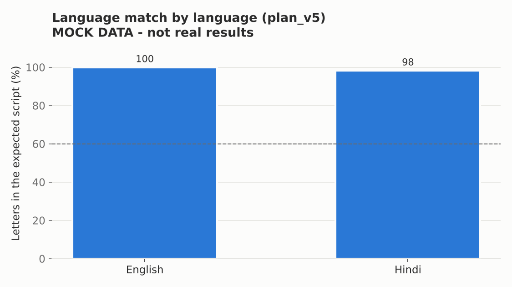

# AI Business Starter Agent

**Business Starter** helps aspiring entrepreneurs in India with limited business knowledge (vegetable
vendors, pickle makers, home cooks, tailors, artisans) turn an idea into a **checked, practical business
plan** and launch it step by step, **in 7 Indian languages**.

It is a prompt-engineering project: five versions of the plan prompt were built and measured on a fixed
test set, from our baseline (plan_v1) to the default (plan_v5). See
[docs/prompt_iterations.md](docs/prompt_iterations.md) and the [evaluation report](data/eval/report.md).

**Stack:** Python · FastAPI · LangChain + LangGraph · open-source LLM (GPT-OSS 120B via Groq, or Llama via
Ollama) · ChromaDB · SQLite · plain HTML/CSS/JS

| Welcome | Chat | Plan | Hindi plan | Checklist + questions |
|---|---|---|---|---|
|  |  |  |  |  |

## Features

- **Simple intake chat** in English, Hindi, Bengali, Marathi, Tamil, Telugu or Gujarati: 5 short
  questions, typing, quick-reply chips or voice; Hinglish and "bees hazaar" style budgets understood.
- **Checked business plan:** costs, pricing and profit, break-even, low/normal/good month estimates,
  marketing ideas, launch steps, risks. **Every rupee is computed by a calculator, not the LLM.**
- **Only real government schemes**, retrieved from official documents (Mudra, PMEGP, PM SVANidhi,
  Stand-Up India, Udyam, FSSAI, GST, trade licence) and shown with their official links.
- **Self-checking agent (LangGraph):** 11 checks (budget, reserve, price, break-even, invented schemes,
  promise words, sections, language, rupee numbers) with a repair loop; problems are shown, never hidden.
- **Launch checklist** saved on the server, a **"Your next step"** card, and an **"Ask a question"**
  advisor with memory that uses the calculator for what-if questions.
- **Mobile-first web app** for cheap phones: big buttons, PDF download, listen to the plan, resume later.
- **Privacy:** Aadhaar, PAN, bank and phone numbers are masked before anything is stored or sent.

## Quick start

```bash
git clone https://github.com/Priyanshshukla2005/Agentic-AI.git && cd Agentic-AI
```
```bash
./run.sh          # Windows: run.bat
```

Then open **http://127.0.0.1:8000** (a phone on the same Wi-Fi can use the LAN address the script prints).
The script creates a virtual environment, installs the requirements and copies `.env.example` to `.env`.
Put your free Groq key in `.env` (`GROQ_API_KEY`, from https://console.groq.com/keys), or set
`LLM_PROVIDER=mock` to try everything offline. Build the scheme index once with
`python scripts/ingest_docs.py`.

Tests and evaluation tools: `pip install -r requirements-dev.txt`, then `pytest` (runs offline).

## Architecture

```
intake chat ─► profile ─► RAG (official schemes) ─► LLM plan (input numbers) ─► calculator ─► validation
                                                        ▲                                       │ problems
                                                        └──────────────── repair ◄───────────────┘
                                         plan ─► checklist + next step ─► Q&A agent (tools + memory)
```

Full diagrams, tech stack, data flow and privacy design: [docs/architecture.md](docs/architecture.md).
Planner graph: [docs/plan_graph.md](docs/plan_graph.md).

## Evaluation results

`python scripts/run_eval.py` runs every prompt version on 15 test profiles (7 languages, budgets
₹3,000-₹1,00,000, 3 edge cases) and measures each plan with code metrics, a **blind LLM judge** and a
**blind human A/B review** (plan_v1 vs plan_v5). Full results: [data/eval/report.md](data/eval/report.md).

> The committed report and charts come from an offline **mock run** that checks the pipeline (they are
> labelled "MOCK"). Replace them with the Groq run before submission: see "Producing the final results".

| | plan_v1 | plan_v2 | plan_v3 | plan_v4 | plan_v5 |
|---|---|---|---|---|---|
| What it adds | baseline | rules + JSON schema | worked examples | grounding in official documents | language guidance |
| Judge score (1-5) | [result] | [result] | [result] | [result] | [result] |
| Invented schemes / plan | [result] | [result] | [result] | [result] | [result] |
| Budget fit | n/a | [result] | [result] | [result] | [result] |

| Judge score | Validation issues | Language match |
|---|---|---|
|  |  |  |

Scheme search (RAG): **hit-rate@4 = 12/12 (100%)**, hit-rate@1 = 9/12 (75%) on 12 questions, 4+ in Hindi/Hinglish.

### Producing the final results (with a Groq key)

```bash
python scripts/ingest_docs.py
```
```bash
python scripts/run_eval.py --resume
```
```bash
python scripts/eval_language.py
```
```bash
python scripts/make_human_review.py
```

Reviewers fill in `data/eval/human_review/review_sheet.csv`, then:

```bash
python scripts/score_human.py
```

The full run makes roughly 160-400 LLM calls, about 250 typically (75 plans, repairs, translations and 75
judge calls). Reduce it with `--no-judge`, `--versions plan_v1,plan_v5` or `--profiles p01,p02,p12`;
`--resume` continues after a rate limit. See [docs/phase_guide.md](docs/phase_guide.md#phase-7-evaluation) for details.

## Documentation

| Document | Contents |
|---|---|
| [docs/prompt_iterations.md](docs/prompt_iterations.md) | **Prompt engineering write-up:** v1 -> v5, why, excerpts, measured effect |
| [docs/architecture.md](docs/architecture.md) | System overview, LangGraph planner, tech stack, data flow, privacy |
| [docs/phase_guide.md](docs/phase_guide.md) | Phase-by-phase reference: setup, every endpoint, design notes, troubleshooting |
| [docs/demo_script.md](docs/demo_script.md) | 3-minute live demo (Hindi flow) with an offline backup plan |
| [docs/report_outline.md](docs/report_outline.md) | Report sections mapped to our submission form |
| [docs/slides_outline.md](docs/slides_outline.md) | 12 slides with visuals |
| [data/docs/README.md](data/docs/README.md) | How to add official scheme PDFs |

## Team

| Member | Role |
|---|---|
| [name] | Prompt engineering and evaluation |
| [name] | Backend, agents (LangGraph) and RAG |
| [name] | Frontend and accessibility |
| [name] | Scheme research, translations and user testing |

## Limitations

- The LLM judge can be biased (blind judging + human review mitigate this); 15 profiles, one run per version.
- Language checks verify the script, not grammar; Bengali, Marathi, Tamil, Telugu and Gujarati need
  native-speaker review. Some backend messages are still English.
- 8 starter scheme documents, mostly from PIB releases; facts must be re-checked on the official sites.
- Market prices come from the model, not live data. No user accounts (sessions are protected only by a random id).

## Future work

- **Voice-first flow** for users who cannot read comfortably.
- **WhatsApp bot**, where our users already are.
- **More languages** via dedicated Indic translation models (e.g. IndicTrans2).
- **Live market price data** (mandi prices, local rents) to ground costs and prices.
