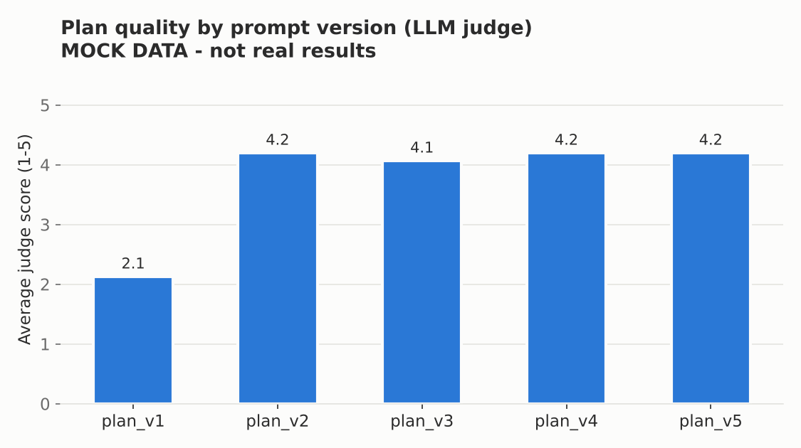
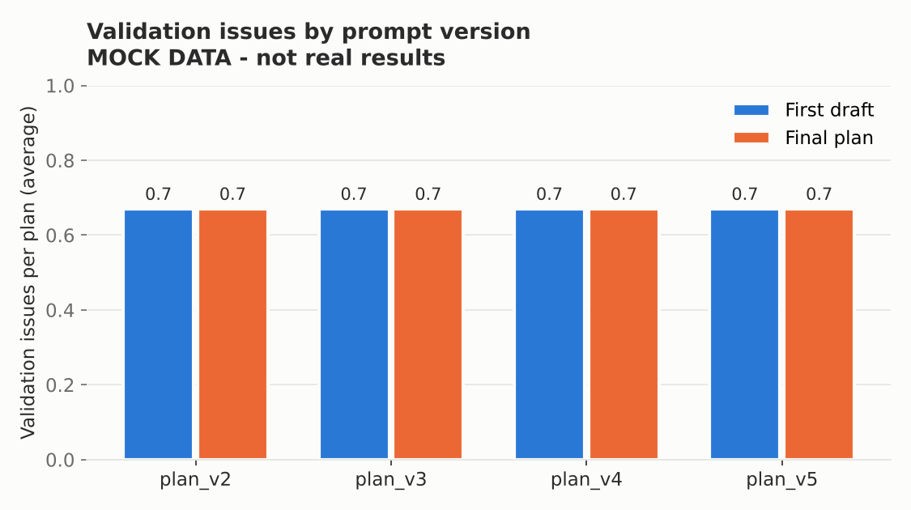
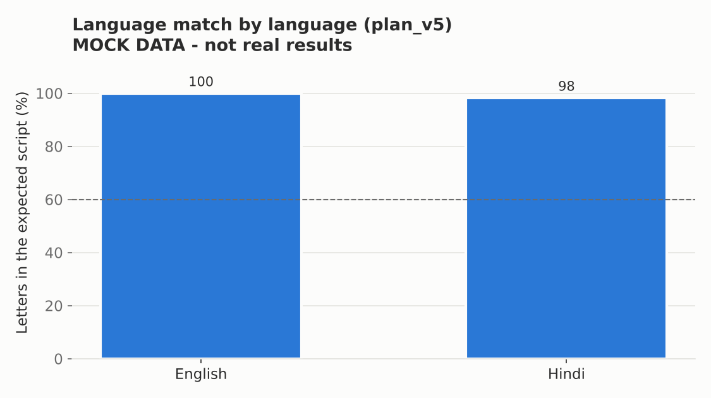

# Evaluation report: plan prompt versions

> **MOCK RUN - NOT REAL RESULTS.** This report was produced with `LLM_PROVIDER=mock` to test the pipeline. The plans and judge scores are fixed stand-ins. Re-run with Groq for the final numbers.

Generated 2026-11-13 10:18 | generator `mock/mock` | judge `mock` | 3 test profiles x 5 versions = 15 plans (0 errors).

## 1. Summary per prompt version

| Version | Plans | Judge avg | Personal. | Practical. | Simplicity | Grounding | Complete. | Structure | Budget fit | Price > cost | Break-even ok | Halluc. schemes | Promise words | Language match | Issues 1st draft | Final passed | Latency (s) |
|---|---|---|---|---|---|---|---|---|---|---|---|---|---|---|---|---|---|
| plan_v1 | 3 | 2.13 | 1.33 | 1 | 2.33 | 4 | 2 | 0.20 | n/a | n/a | n/a | 0 | 0 | 33% | n/a | n/a | 1.9 |
| plan_v2 | 3 | 4.20 | 4 | 3 | 4 | 5 | 5 | 1 | 33% | 100% | 100% | 0 | 0 | 33% | 0.67 | 33% | 0.1 |
| plan_v3 | 3 | 4.07 | 3.67 | 3 | 3.67 | 5 | 5 | 1 | 33% | 100% | 100% | 0 | 0 | 33% | 0.67 | 33% | 0.1 |
| plan_v4 | 3 | 4.20 | 4 | 3 | 4 | 5 | 5 | 1 | 33% | 100% | 100% | 0 | 0 | 99% | 0.67 | 33% | 0.1 |
| plan_v5 | 3 | 4.20 | 4 | 3 | 4 | 5 | 5 | 1 | 33% | 100% | 100% | 0 | 0 | 99% | 0.67 | 33% | 0.1 |

Judge scores are 1-5 (blind LLM judge). Budget fit / price > cost / break-even ok / final passed are % of plans (n/a for the free-text plan_v1). Hallucinated schemes and promise words are averages per plan. Language match = % of letters in the user's script.







## 2. What improved from plan_v1 to the latest version

- **Judge score:** 2.13 -> 4.20 out of 5 (+2.07).
- **Structure:** 0.20 -> 1. The baseline is free text; from plan_v2 the output follows a fixed schema, so every plan has costs, pricing, marketing, launch steps, risks and assumptions.
- **Money maths:** plan_v1 numbers are written by the model and cannot be checked; in plan_v5 every total comes from the calculator. Budget fits in 33% of plan_v5 plans, price is above cost in 100%.
- **Invented schemes:** 0 -> 0 per plan (plan_v4 and later may only use schemes from the retrieved official documents).
- **Promise words** ("guaranteed", "pakka munafa"): 0 -> 0 per plan.
- **Language match:** 33% -> 99% of letters in the user's script.
- **Validation:** 33% of plan_v5 plans pass all checks after repair (first drafts had 0.67 issues on average).
- **Cost:** average time per plan 1.9 s -> 0.1 s (structured output, retrieval, validation and repairs usually add time).

## 3. Edge cases

No edge-case profiles in this run (p12, p13, p14 are the edge cases).

## 4. Languages

Plans from **plan_v5** grouped by language:

| Language | Plans | Mode | Language match | WRONG_LANGUAGE | NUMBER_MISMATCH | Passed |
|---|---|---|---|---|---|---|
| English | 1 | direct | 100% | 0/1 | 0/1 | 100% |
| Hindi (हिन्दी) | 2 | direct | 98% | 0/2 | 0/2 | 0% |

#### Language evaluation from scripts/eval_language.py (2 sample profiles x 7 languages)


Generated 2026-11-13 09:48 with `mock/mock`, TRANSLATE_MODE=`auto`, sample profiles [0, 1].

| Language | Mode | Script match | WRONG_LANGUAGE | NUMBER_MISMATCH | Passed validation | Avg seconds |
|---|---|---|---|---|---|---|
| English | direct | 100% | 0/2 | 0/2 | 1/2 | 5.1 |
| Hindi (हिन्दी) | direct | 99% | 0/2 | 0/2 | 1/2 | 0.1 |
| Bengali (বাংলা) | pivot | 0% | 2/2 | 0/2 | 0/2 | 0.1 |
| Marathi (मराठी) | pivot | 0% | 2/2 | 0/2 | 0/2 | 0.1 |
| Tamil (தமிழ்) | pivot | 0% | 2/2 | 0/2 | 0/2 | 0.1 |
| Telugu (తెలుగు) | pivot | 0% | 2/2 | 0/2 | 0/2 | 0.1 |
| Gujarati (ગુજરાતી) | pivot | 0% | 2/2 | 0/2 | 0/2 | 0.0 |

Script match = share of letters written in the expected script (Devanagari for Hindi/Marathi, Bengali, Tamil, Telugu, Gujarati, Latin for English). Below 60% counts as WRONG_LANGUAGE.
Mock mode only has English and Hindi plans and cannot translate, so the other languages are expected to show WRONG_LANGUAGE here. Run with Groq for real numbers.

## 5. Side by side: plan_v1 vs plan_v5

### Example 1: p01 (English) - Home tiffin service for office workers, ₹25,000

**plan_v1 (baseline prompt, free text)**

```text
Business Plan (MOCK MODE - free text, not validated)
Startup: stove, utensils and boxes about Rs 10,000. Price Rs 170 per meal.
Set LLM_PROVIDER=groq or ollama in .env to get real answers.
```

**plan_v5 (structured, grounded, calculator numbers, language rules)**

```text
SUMMARY
A home kitchen in Ghaziabad that cooks fresh, high-protein lunch boxes for gym-goers. Meals are delivered near 3-4 local gyms. Start small with lunch only and grow with regular monthly customers.

STARTUP COSTS
- Gas stove and pressure cooker: Rs 3,500
- Utensils and kitchen scale: Rs 2,500
- Insulated delivery bag and 30 steel boxes: Rs 2,000
- First stock of disposable boxes: Rs 1,500
- Printed menu cards for gyms: Rs 500
MONTHLY COSTS
- Cooking gas: Rs 1,200
- Delivery fuel: Rs 1,300
- Phone and internet: Rs 500

MONEY (calculated)
- Budget Rs 25,000, needed to start Rs 13,000, left Rs 12,000
- Cost per meal Rs 100, price Rs 170, profit per unit Rs 70
- Break-even: Sell at least …
```

### Example 2: p02 (Hindi (हिन्दी)) - घर पर बने अचार और पापड़, ₹6,000

**plan_v1 (baseline prompt, free text)**

```text
Business Plan (MOCK MODE - free text, not validated)
Startup: stove, utensils and boxes about Rs 10,000. Price Rs 170 per meal.
Set LLM_PROVIDER=groq or ollama in .env to get real answers.
```

**plan_v5 (structured, grounded, calculator numbers, language rules)**

```text
SUMMARY
गाज़ियाबाद में घर की रसोई से जिम जाने वालों के लिए ताज़ा, ज़्यादा प्रोटीन वाला लंच बॉक्स। खाना पास के 3-4 जिम के आसपास पहुँचाया जाएगा। शुरुआत सिर्फ़ दोपहर के खाने से करें और हर महीने वाले पक्के ग्राहक बनाकर आगे बढ़ें।

STARTUP COSTS
- गैस चूल्हा और प्रेशर कुकर: Rs 3,500
- बर्तन और रसोई का तराज़ू: Rs 2,500
- डिलीवरी बैग और 30 स्टील के डिब्बे: Rs 2,000
- डिस्पोज़ेबल डिब्बों का पहला स्टॉक: Rs 1,500
- जिम के लिए छपे मेन्यू कार्ड: Rs 500
MONTHLY COSTS
- रसोई गैस: Rs 1,200
- डिलीवरी का पेट्रोल: Rs 1,300
- फ़ोन और इंटरनेट: Rs 500

MONEY (calculated)
- Budget Rs 6,000, needed to start Rs 13,000, left -Rs 7,000
- Cost per थाली Rs 100, price Rs 170, profit per unit Rs 70
- Break-even: Sell at …
```


## 6. Scheme search (RAG)

- **hit-rate@4: 12/12 = 100%** (expected scheme among the top 4 chunks)
- hit-rate@1: 9/12 = 75%
- 12 questions, 4+ in Hindi/Hinglish, embedding model `sentence-transformers/paraphrase-multilingual-MiniLM-L12-v2`

## 7. Human review (blind A/B, plan_v1 vs plan_v5)

<!-- human-review:start -->
No filled-in ratings found yet in the review sheet.
<!-- human-review:end -->

## Limitations

- **LLM judge bias:** a model judge can prefer longer or more structured answers, or its own style (especially if the judge and generator are the same model). Judging is blind (no version shown, shuffled order, temperature 0), and we add a blind human review for this reason.
- **Small test set:** 15 profiles, one run per version at temperature 0.3; differences of a few tenths may be noise.
- **Language match** only checks the script, not grammar or naturalness; native speakers should read the plans.
- **Scheme facts** come from our starter documents (mostly PIB releases); they must be re-checked against the official scheme websites.
