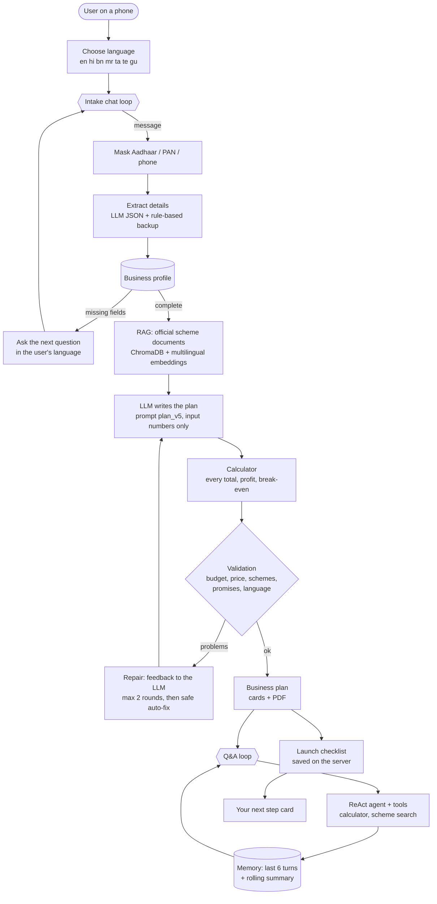
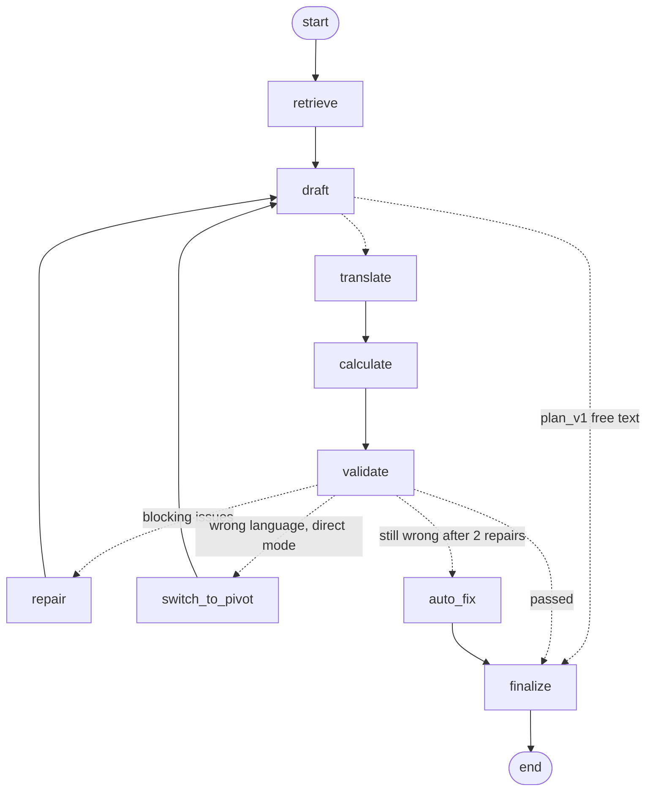

# Architecture

Business Starter helps first-time entrepreneurs in India turn an idea into a checked, practical
plan and then launch it step by step, in 7 languages. One FastAPI server hosts the API and the web
app; LangChain/LangGraph connect it to an open-source LLM (GPT-OSS via Groq, or Llama via Ollama).

## System overview

## Plan generation graph (LangGraph)

The planner in [`app/planner.py`](../app/planner.py) is a LangGraph state machine. Full diagram and
node descriptions: [plan_graph.md](plan_graph.md).

## Tech stack

| Layer | Choice | Why |
|---|---|---|
| LLM | GPT-OSS 120B on Groq (free tier); Llama 3.1 8B via Ollama offline; mock for tests | Open-weight models, fast and free to try; Ollama keeps a fully offline option |
| LLM framework | LangChain (prompts, structured output, tools) | One interface for all providers; `with_structured_output` with fallbacks |
| Agents | LangGraph (`StateGraph` planner, prebuilt ReAct agent for Q&A) | Explicit, testable steps: retrieve, draft, calculate, validate, repair |
| Retrieval | ChromaDB + `paraphrase-multilingual-MiniLM-L12-v2` | Runs on CPU; Hindi/Hinglish questions match English documents |
| Maths | Pure Python calculator | LLMs are unreliable at arithmetic; every number is reproducible |
| Backend | FastAPI + Pydantic | Typed request/response models, automatic API docs at `/docs` |
| Storage | SQLite (stdlib `sqlite3`) | Zero setup, one file, survives restarts |
| Frontend | Plain HTML/CSS/JS (ES modules), Noto fonts | No build step; light enough for cheap phones; Indian scripts render |
| Evaluation | Metrics in code, blind LLM judge, blind human A/B review, matplotlib | Comparable numbers for every prompt version |
| Tests | pytest (offline, mock LLM), Playwright smoke test | Everything runs without an API key |

## Data flow

1. **Intake** (`POST /api/session`, `POST /api/chat`): each message is masked for personal numbers,
   details are extracted (LLM JSON, rule-based backup), merged into the `BusinessProfile`; the code
   decides the next missing field and the LLM phrases the question in the user's language.
2. **Plan** (`POST /api/plan`): the LangGraph planner retrieves scheme chunks for the profile, the LLM
   writes a `PlanDraft` with input numbers only (directly in the language, or in English + translation),
   the calculator computes the `FinancialSummary`, the validator checks it, repairs/auto-fixes if
   needed, and the final `BusinessPlan` (with validation report and sources) is saved.
3. **Checklist** (`/api/checklist/...`): the plan's launch steps become checklist items; users tick
   steps and add their own; regenerating keeps own steps and ticks on unchanged steps.
4. **Q&A** (`POST /api/ask`): profile + plan numbers + checklist + memory + RAG chunks go to a ReAct agent
   with the calculator and scheme-search tools; answers are checked for promise words and language and
   stored with their sources. `GET /api/guide/{id}` gives the next step with a tip.
5. **Evaluation** (`scripts/run_eval.py`): the planner runs on the 15 test profiles for each prompt
   version; metrics, judge scores, charts and `data/eval/report.md` are produced.

## Code map

| Folder / file | Role |
|---|---|
| `app/main.py` | FastAPI app, routers, startup summary |
| `app/intake.py`, `app/models.py` | Intake chat (Phase 2) |
| `app/rag.py`, `scripts/ingest_docs.py`, `data/docs/` | Scheme documents and search (Phase 3) |
| `app/calculator.py`, `app/tools.py` | Calculator and LangChain tools (Phase 3) |
| `app/planner.py`, `app/plan_validation.py`, `app/plan_models.py` | Plan agent and checks (Phase 4) |
| `app/static/` | Web app (Phase 5) |
| `app/db.py`, `app/session_store.py`, `app/checklist.py`, `app/advisor.py` | Persistence, checklist, Q&A (Phase 6) |
| `app/language.py`, `app/translation.py` | Language checks and pivot translation (Phase 6) |
| `app/evaluation/` | Metrics, judge, runner, report, charts, human review (Phase 7) |
| `app/prompts/` | Every prompt, versioned |

## Privacy design

- **Personal numbers never stored or sent:** Aadhaar, PAN, bank account and phone numbers are masked by
  regular expressions before a message is stored or sent to the LLM (intake and Q&A); the user is told
  they were not saved. The prompts tell the model never to ask for them.
- **Minimal data:** only the language, the business profile, chats, plans, checklist and Q&A are stored
  in `data/app.db`; no names, logins, passwords or locations finer than a town.
- **Local by default:** data stays on the machine running the server; delete `data/app.db` to erase it.
  With Ollama even the LLM runs locally; with Groq only masked text leaves the machine.
- **Honest output:** money numbers come from the calculator, schemes only from official documents (with
  links), promise words are removed, and every remaining problem is shown to the user, never hidden.
- **Known gap:** there are no user accounts; anyone with a session id can open that session. Fine for a
  demo on a trusted network, not for a public deployment.
