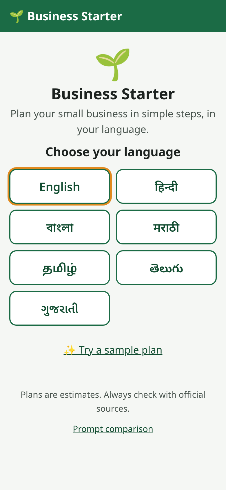
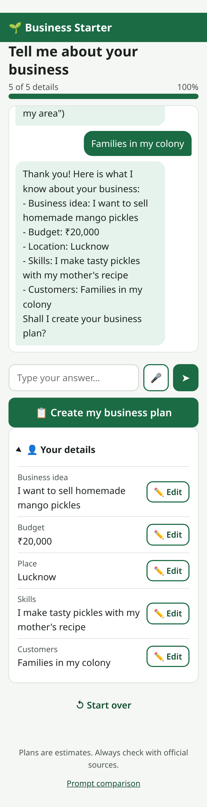
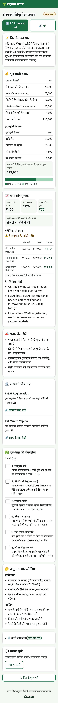

# Phase-by-phase guide

> This is the detailed, phase-by-phase reference (setup, every endpoint, design notes, troubleshooting).
> Start with the short [README](../README.md).

An agentic AI system that helps aspiring entrepreneurs with limited business knowledge
create personalized business plans, budget-based pricing and step-by-step launch guidance.

**Stack:** Python · FastAPI · LangChain · open-source LLM (GPT-OSS via Groq, or Llama via Ollama)

## Status

| Phase | What | Status |
|---|---|---|
| 1 | Setup + LLM connection (groq / ollama / mock) | ✅ Done |
| 2 | Multilingual intake chat (collects the business profile) | ✅ Done |
| 3 | RAG over official scheme documents + pricing/profit calculator | ✅ Done |
| 4 | Plan generation agent (LangGraph) + validation + repair | ✅ Done |
| 5 | Mobile-first web app (7 languages) + prompt comparison page | ✅ Done |
| 6 | SQLite persistence, server checklist, Q&A agent with memory, plan_v5 + language checks | ✅ Done |
| 7 | Evaluation (metrics, blind judge, human review), docs, run scripts | ✅ Done |

```
ai-business-starter/
├── app/
│   ├── main.py            # FastAPI server: /health, /api/test-prompt + Phase 2 router
│   ├── llm.py             # LLM switcher (groq / ollama / mock) via LangChain
│   ├── config.py          # Reads settings from .env
│   ├── models.py          # Phase 2: BusinessProfile, ProfileUpdate, ProfilePatch, languages
│   ├── session_store.py   # Phase 2: in-memory sessions (swap for SQLite in Phase 6)
│   ├── intake.py          # Phase 2: one chat turn = mask PII -> extract -> merge -> reply
│   ├── rag.py             # Phase 3: load/split/embed docs, search ChromaDB, profile -> searches
│   ├── calculator.py      # Phase 3: budget, price, break-even, scenarios, GST/FSSAI flags (no LLM)
│   ├── tools.py           # Phase 3: LangChain @tool wrappers for the Phase 4 agent (ALL_TOOLS)
│   ├── structured.py      # Phase 4: LLM -> pydantic object with 3 fallbacks (used by intake + plan)
│   ├── plan_models.py     # Phase 4: PlanDraft, ValidationReport, BusinessPlan
│   ├── plan_validation.py # Phase 4: rule-based checks + auto-fix (no LLM)
│   ├── plan_mock.py       # Phase 4: fixed valid / invalid drafts for mock mode
│   ├── planner.py         # Phase 4: LangGraph agent: retrieve -> draft -> translate -> calculate -> validate -> ...
│   ├── db.py              # Phase 6: SQLite connection + tables (data/app.db)
│   ├── checklist.py       # Phase 6: launch checklist stored on the server
│   ├── advisor.py         # Phase 6: Q&A agent (ReAct + tools + memory) and next-step guide
│   ├── language.py        # Phase 6: script detection (7 languages) + rupee number checks
│   ├── translation.py     # Phase 6: pivot mode (English draft -> user's language, numbers kept)
│   ├── static/            # Phase 5: the web app (plain HTML/CSS/JS, no build step)
│   │   ├── index.html     #   app shell: welcome -> chat -> plan
│   │   ├── compare.html   #   prompt comparison page
│   │   ├── css/styles.css #   mobile-first styles + print stylesheet ("Download PDF")
│   │   └── js/            #   api.js, i18n.js (7 languages), app.js, plan_view.js, compare.js
│   ├── routes/
│   │   ├── frontend.py    # Phase 5: GET /, /compare.html, /api/samples
│   │   ├── intake.py      # Phase 2: /api/session, /api/chat endpoints
│   │   ├── tools.py       # Phase 3: /api/rag/..., /api/calculate endpoints
│   │   ├── plan.py        # Phase 4: /api/plan endpoints
│   │   ├── checklist.py   # Phase 6: /api/checklist endpoints
│   │   └── advisor.py     # Phase 6: /api/ask, /api/guide endpoints
│   └── prompts/
│       ├── baseline_v1.txt          # Phase 1 baseline plan prompt
│       ├── intake_extract_v1.txt    # Phase 2: pull details out of a message (with Hinglish examples)
│       ├── intake_question_v1.txt   # Phase 2: ask the next question in the user's language
│       ├── intake_summary_v1.txt    # Phase 2: summary + "Shall I create your business plan?"
│       ├── intake_templates_v1.json # Phase 2: field labels + fixed mock-mode messages (en, hi)
│       ├── plan_v1.txt ... plan_v5.txt  # Phase 4/6: plan prompt versions (see table below)
│       ├── translate_v1.txt         # Phase 6: pivot-mode translation (keeps numbers + URLs)
│       ├── qa_v1.txt, qa_summary_v1.txt, qa_guide_v1.txt, qa_templates_v1.json  # Phase 6: Q&A
│       ├── plan_input_v1.txt        # Phase 4: profile + repair feedback (human message)
│       └── plan_repair_v1.txt       # Phase 4: "fix these problems" feedback text
├── data/
│   ├── docs/                # Phase 3: official scheme documents (.md now, add PDFs any time)
│   └── eval/
│       ├── rag_questions.json   # Phase 3: 12 test questions for the RAG hit-rate
│       ├── sample_profiles.json # Phase 4: 5 complete profiles for plan generation
│       └── language_report.md   # Phase 6: output of scripts/eval_language.py
├── docs/
│   ├── plan_graph.md        # Phase 4: Mermaid diagram of the plan agent
│   └── screenshots/         # Phase 5: app screenshots made by scripts/smoke_ui.py
├── chroma_db/               # Phase 3: vector database, built by ingest_docs.py (NOT committed)
├── scripts/
│   ├── test_llm.py          # Phase 1 terminal test - no server needed
│   ├── chat_cli.py          # Phase 2 terminal chat - no server needed
│   ├── ingest_docs.py       # Phase 3: build the scheme index
│   ├── eval_rag.py          # Phase 3: hit-rate@4 of scheme search
│   ├── generate_plan_cli.py # Phase 4: generate / compare plans in the terminal
│   ├── smoke_ui.py          # Phase 5: clicks through the app in a headless browser, saves screenshots
│   ├── eval_language.py     # Phase 6: plan quality per language (script match, checks, time)
│   └── list_groq_models.py  # Shows which Groq models your key can use
├── tests/
│   ├── test_intake.py       # Phase 2 tests (offline, mock mode)
│   ├── test_calculator.py   # Phase 3 calculator tests (exact numbers)
│   ├── test_rag.py          # Phase 3 RAG tests (fake embeddings, no download)
│   ├── test_validation.py   # Phase 4: every validation rule
│   ├── test_planner.py      # Phase 4: the whole graph (mock + fake LLM)
│   ├── test_plan_api.py     # Phase 4: /api/plan endpoints
│   ├── test_frontend.py     # Phase 5: static files + /api/samples
│   ├── test_db.py           # Phase 6: SQLite tables, restart, plan history
│   ├── test_checklist.py    # Phase 6: checklist API + regeneration rules
│   ├── test_advisor.py      # Phase 6: Q&A, memory, tools, fallback, guide
│   └── test_language.py     # Phase 6: script detection, pivot retry, number checks
├── requirements.txt
└── .env.example
```

## Setup (10 minutes)

**1. Install Python 3.10+**, then in this folder:

```bash
python -m venv venv
# Windows:
venv\Scripts\activate
# Mac/Linux:
source venv/bin/activate

pip install -r requirements.txt
```

**2. Create your `.env` file**

```bash
# Windows:
copy .env.example .env
# Mac/Linux:
cp .env.example .env
```

**3. Pick an LLM (choose ONE):**

| Option | Steps |
|---|---|
| **Groq (recommended)**: free, fast, no GPU needed | Sign up at https://console.groq.com/keys → create key → paste into `.env` as `GROQ_API_KEY=...` |
| **Ollama**: runs on your laptop, works offline | Install from https://ollama.com → run `ollama pull llama3.1:8b` → set `LLM_PROVIDER=ollama` in `.env` |
| **Mock**: no LLM, just to test the app | Set `LLM_PROVIDER=mock` |

**4. Test the LLM connection**

```bash
python scripts/test_llm.py
```

You should see a business plan for the Ghaziabad meal-service example, then `Phase 1 works!`

**5. Run the server**

```bash
uvicorn app.main:app --reload
```

Open http://127.0.0.1:8000/docs → **POST /api/test-prompt** → *Try it out* → *Execute*.

## Phase 2: Intake chat

The agent chats with the user in their language (English, Hindi, Bengali, Marathi, Tamil,
Telugu, Gujarati) and fills in a business profile, one question at a time.

**Required** (asked in this order): `business_idea`, `budget_inr`, `location`, `skills`, `target_customers`.
**Optional** (saved if mentioned, never asked): `time_available`, `sales_channel`, `experience`, `extra_notes`.

### How one chat turn works (`app/intake.py`)

```
user message
   │
   ├─ 1. PRIVACY   mask Aadhaar / PAN / bank account / phone numbers  (never stored, never sent to the LLM)
   ├─ 2. EXTRACT   LLM structured output: json_schema → function_calling → raw JSON
   │               └─ all fail, or mock mode → rule-based extractor (regex + keywords)
   ├─ 3. MERGE     copy non-empty values into the profile (new values overwrite → corrections work)
   │               budget text → rupees in CODE: "1.5 lakh" → 150000, "bees hazaar" → 20000
   └─ 4. RESPOND   missing fields? → ONE simple question for the first missing field
                   all filled?     → summary + "Shall I create your business plan?"
```

* **Missing fields are decided in Python** (`BusinessProfile.missing_fields()`), not by the LLM,
  so the question order is predictable and testable.
* **Off-topic questions** ("GST chahiye?") get a one-line answer, then the agent asks the same question again.
* **Mock mode** uses fixed template questions (English + Hindi; other languages fall back to English).
* **Prompts are versioned files.** To try a new prompt, copy `intake_question_v1.txt` to `_v2.txt`
  and change the constant at the top of `app/intake.py`. In prompt files, `{placeholders}` are filled by
  LangChain's `ChatPromptTemplate`; literal braces (like the JSON examples) are written `{{ }}`.

### Endpoints

| Method | Path | Body | Returns |
|---|---|---|---|
| GET | `/health` | | server status + provider (Phase 1) |
| POST | `/api/test-prompt` | business details | plan from a prompt (Phase 1) |
| POST | `/api/session` | `{"language": "hi"}` | `session_id`, `reply` (greeting + first question), `profile`, `missing_fields`, `is_complete` |
| POST | `/api/chat` | `{"session_id": "...", "message": "..."}` | `reply`, `profile`, `missing_fields`, `is_complete` |
| GET | `/api/session/{id}` | | full session: profile + all messages (PII masked) |
| PATCH | `/api/session/{id}/profile` | partial profile, e.g. `{"budget_inr": "1.5 lakh"}` | updated profile (`null` or `""` clears a field) |

Errors: **404** unknown session · **422** unsupported language / bad field / unreadable budget ·
**500** LLM not configured (e.g. missing key) · **502** LLM call failed (the session is left unchanged, just retry).

### Try it in the terminal (no server)

```bash
python scripts/chat_cli.py                    # uses LLM_PROVIDER from .env
LLM_PROVIDER=mock python scripts/chat_cli.py  # offline, fixed questions
```

(Windows PowerShell: `$env:LLM_PROVIDER="mock"; python scripts/chat_cli.py`)

Pick a language, then chat. The profile JSON is printed after every turn; the chat stops when the profile is complete.

### Run the tests

```bash
pip install -r requirements-dev.txt
pytest -v
```

Phase 3 tests use fake embeddings and a temporary database, so they also run offline.
Tests always run in mock mode (forced in `tests/conftest.py`), so they need no API key and no internet.
They cover budget parsing (digits, `k`, lakh, Hindi words), PII masking, question order, a full API chat,
budget corrections, the PATCH endpoint, error codes, and the LLM fallback chain (with a fake model).

### Sample conversation with curl (mock mode)

```bash
curl -X POST localhost:8000/api/session -H "Content-Type: application/json" -d '{"language": "en"}'
```
```json
{"session_id": "ea7348cf-...", "reply": "Namaste! I will help you plan your business, one small question at a time.\nWhat business do you want to start? (Example: \"I want to sell homemade pickles\")",
 "missing_fields": ["business_idea", "budget_inr", "location", "skills", "target_customers"], "is_complete": false, "profile": {...}}
```

```bash
curl -X POST localhost:8000/api/chat -H "Content-Type: application/json" -d '{"session_id": "ea7348cf-...", "message": "I want to start a tiffin service"}'
```
```json
{"reply": "Got it, thank you!\nHow much money can you put into this business? (Example: \"20,000 rupees\" or \"1 lakh\")",
 "missing_fields": ["budget_inr", "location", "skills", "target_customers"], "is_complete": false, ...}
```

Then send `"Rs. 50k"`, `"I live in Pune"`, `"I cook good home-style food"`, `"Students and office workers"`. The last reply is:

```json
{"reply": "Thank you! Here is what I know about your business:\n- Business idea: I want to start a tiffin service\n- Budget: ₹50,000\n- Location: Pune\n- Skills: I cook good home-style food\n- Customers: Students and office workers\nShall I create your business plan?",
 "missing_fields": [], "is_complete": true, ...}
```

Fix a field directly:

```bash
curl -X PATCH localhost:8000/api/session/ea7348cf-.../profile -H "Content-Type: application/json" -d '{"budget_inr": "1.5 lakh"}'
```

With Groq or Ollama, the replies are written by the LLM in the chosen language and a single message
can fill several fields at once (e.g. *"mere paas bees hazaar hai, Lucknow mein tiffin service"*).

## Phase 3: Scheme search (RAG) + money calculator

Phase 4 will give the agent two tools, and both are ready now:

* **RAG (`app/rag.py`)** finds the right government schemes in official documents, with the source link.
* **Calculator (`app/calculator.py`)** does ALL the money maths in plain Python. The LLM never calculates
  prices or profits itself; it only explains the calculator's numbers.

### Install the extra packages

```bash
# Optional but recommended: CPU-only torch is ~2 GB smaller than the default build
pip install torch --index-url https://download.pytorch.org/whl/cpu
pip install -r requirements.txt
```

### How the RAG works

```
INDEX (once):  data/docs/*.md|.txt|.pdf ─► chunks of 800 chars (120 overlap) ─► multilingual embeddings ─► chroma_db/
SEARCH:        question ─► embedding ─► 4 closest chunks ─► drop if score < RAG_MIN_SCORE ─► chunks + source URLs
```

* The embedding model `paraphrase-multilingual-MiniLM-L12-v2` understands Hindi and other Indian languages,
  so *"ठेले पर फल बेचता हूँ, लोन मिलेगा?"* finds the English PM SVANidhi document. It runs on CPU.
* `build_query_from_profile()` turns a profile into 2-3 focused searches: a loan sized to the budget,
  a licence search (food -> FSSAI, otherwise Udyam/GST) and, if relevant, a street-vendor,
  women/SC-ST or subsidy search. `retrieve_for_profile()` merges them without duplicates.
* `format_context()` gives a numbered block like `[1] [source: PM SVANidhi | https://...]` for the Phase 4 prompt.

### Build the index and measure it

```bash
python scripts/ingest_docs.py   # first run downloads the embedding model (~470 MB)
python scripts/eval_rag.py      # prints hit-rate@4 and lists misses
```

Current result on the 12 test questions (4 in Hindi/Hinglish): **hit-rate@4 = 12/12 (100%)**,
hit-rate@1 = 9/12 (75%). Off-topic questions ("how to train my pet dog") return no results because
of the relevance threshold.

### Adding official PDFs

Drop official PDFs into `data/docs/` and run `python scripts/ingest_docs.py` again (it rebuilds the
index cleanly, no duplicates). Then run `python scripts/eval_rag.py` to check the score.
Details and rules: [data/docs/README.md](../data/docs/README.md).

Starter documents (each fact taken from an official page, linked in the file's `source_url`):
PM Mudra Yojana, PMEGP, PM SVANidhi, Stand-Up India, Udyam Registration, FSSAI Registration,
GST Registration basics, Trade License / Shop Act.

### The calculator (all money in whole rupees)

| Function | What it answers |
|---|---|
| `budget_summary(items, budget)` | Do one-time costs + first month fit the budget? Warns if over budget or reserve < 10% |
| `unit_economics(cost, price)` | Profit and margin on one item. Warns if price <= cost |
| `suggest_price(cost, margin=40, low, high)` | Price for a target margin, rounded to Rs 5, kept inside the market range |
| `break_even(fixed, profit_per_unit, days=26)` | Sales needed per month/day. "Not possible" if there is no profit per item |
| `monthly_scenarios(...)` | Revenue, cost, profit for low / expected / high months (ESTIMATES) |
| `payback_months(startup, monthly_profit)` | Months to earn the investment back (None if no profit) |
| `compliance_flags(revenue, food, service)` | GST and FSSAI hints from the official limits in `THRESHOLDS` |
| `full_financials(input)` | All of the above in one `FinancialSummary` |

### Phase 3 endpoints

| Method | Path | Body | Returns |
|---|---|---|---|
| POST | `/api/rag/search` | `{"query": "...", "k": 4, "category": "loan"}` (k, category optional) | matching chunks with `scheme`, `source_url`, `score` + ready `context` |
| POST | `/api/rag/for-session` | `{"session_id": "..."}` | schemes for that intake profile + the searches used |
| GET | `/api/rag/sources` | | every scheme in the index with its official URL |
| POST | `/api/calculate` | `FinancialInput` (see below) | `FinancialSummary` |

Errors: **400** empty query / impossible input (e.g. market_low > market_high) · **404** unknown session ·
**422** wrong field types or unknown category · **503** index not built yet (run `python scripts/ingest_docs.py`).

`category` is one of `loan`, `subsidy`, `registration`, `license`, `tax`.

### Example: `/api/calculate` (healthy-meal tiffin business)

```bash
curl -X POST localhost:8000/api/calculate -H "Content-Type: application/json" -d '{
  "budget_inr": 20000,
  "cost_items": [
    {"name": "Stove and utensils", "amount_inr": 6000, "kind": "one_time"},
    {"name": "Kitchen rent share", "amount_inr": 3000, "kind": "monthly"}
  ],
  "unit_cost": 100, "selling_price": 170,
  "units_per_day_low": 5, "units_per_day_expected": 10, "units_per_day_high": 15,
  "is_food_business": true
}'
```

Response (the low and high scenarios are left out here to keep it short):

```json
{
  "budget": {
    "budget_inr": 20000,
    "one_time_total": 6000,
    "monthly_total": 3000,
    "startup_need": 9000,
    "remaining": 11000,
    "percent_used": 45.0,
    "over_budget": false,
    "warnings": []
  },
  "price": {
    "suggested_price": 165,
    "unit_cost": 100,
    "margin_percent": 39.4,
    "reason": "Cost Rs 100 + 40% margin, rounded to the nearest Rs 5.",
    "warnings": []
  },
  "unit": {
    "unit_cost": 100,
    "selling_price": 170,
    "profit_per_unit": 70,
    "margin_percent": 41.2,
    "warnings": []
  },
  "break_even": {
    "possible": true,
    "units_per_month": 43,
    "units_per_day": 2,
    "message": "Sell at least 43 units a month (about 2 a day over 26 working days) to cover fixed costs."
  },
  "scenarios": {
    "scenarios": [
      {
        "label": "expected",
        "units_per_day": 10,
        "units_per_month": 260,
        "revenue": 44200,
        "total_cost": 29000,
        "profit": 15200
      }
    ],
    "note": "These are ESTIMATES based on your numbers, not guarantees. Real sales and costs will differ."
  },
  "payback_months": 0.4,
  "compliance": {
    "annual_revenue_estimate": 530400,
    "flags": [
      "GST: below the GST registration limit, not needed yet (verify).",
      "FSSAI: basic FSSAI Registration is needed before selling food (turnover up to Rs 12,00,000) (verify).",
      "Udyam: free MSME registration, useful for loans and schemes (recommended)."
    ]
  },
  "warnings": [],
  "disclaimer": "These are ESTIMATES based on your numbers, not guarantees. Real sales and costs will differ."
}
```

Leave out `selling_price` to use the suggested price; leave out `fixed_monthly_costs` to use the total of the
`monthly` cost items.

## Phase 4: Business plan generation + validation

```
complete profile ─► RAG retrieval ─► LLM writes plan ─► calculator ─► validate ─┬─ ok ─────────────► final plan
                                          ▲                                       ├─ problems ─► repair (feedback to LLM, max 2 rounds)
                                          └───────────────────────────────────────┘
                                                                                  └─ still wrong ─► auto_fix ─► final plan (with warnings)
```

**Core rule:** the LLM only proposes INPUT numbers (costs, unit cost, price, market range, expected sales).
The calculator computes every total, profit, break-even and payback, and the final plan shows only
calculator numbers.

### The agent graph (`app/planner.py`, LangGraph)

Diagram: [docs/plan_graph.md](plan_graph.md) (regenerate with `python -m app.planner`).

| Node | What it does |
|---|---|
| `retrieve` | `rag.retrieve_for_profile(profile)`. Index missing -> empty context + warning, no crash |
| `draft` | Builds the prompt for the chosen version and gets a `PlanDraft` via `invoke_structured` (plan_v1: free text -> straight to `finalize`) |
| `calculate` | `calculator.full_financials(...)` from the draft numbers + the profile budget |
| `validate` | Plain Python rules (table below), no LLM |
| `repair` | Blocking issues -> "Fix these problems: ..." feedback -> back to `draft` (at most 2 rounds) |
| `auto_fix` | After the last round: drop invented schemes, soften promise words. Budget/price problems stay visible |
| `finalize` | Builds the `BusinessPlan`, records timings per node, saves it in the session |

`generate_plan(profile, language, prompt_version=None) -> BusinessPlan` runs the whole graph
(`None` = `DEFAULT_PLAN_VERSION`, which is `plan_v5` since Phase 6).

### Validation rules (`app/plan_validation.py`)

| Code | Severity | Triggered when |
|---|---|---|
| `BUDGET_OVER` | blocking | one-time costs + first month of fixed costs > budget |
| `LOW_RESERVE` | warning | less than 10% of the budget is left |
| `PRICE_BELOW_COST` | blocking | selling price <= unit cost |
| `PRICE_OUT_OF_MARKET` | warning | price outside the market low-high range |
| `BREAK_EVEN_UNREALISTIC` | blocking | break-even units/day > units_per_day_high |
| `HALLUCINATED_SCHEME` | blocking | scheme name or source_url not in the retrieved documents |
| `GUARANTEE_LANGUAGE` | blocking | promise words in any text: "guaranteed", "100% profit", "risk-free", "definitely earn", "pakka munafa", "गारंटी" ... ("bina guarantee" loans and "Credit Guarantee Fund" are allowed) |
| `MISSING_SECTION` | blocking | empty marketing_ideas, launch_steps or assumptions |
| `BAD_STEP_COUNT` | blocking | launch steps not between 5 and 8 |
| `INVALID_NUMBERS` | blocking | the calculator could not use the numbers |

Blocking issues trigger a repair round; warnings are shown in the plan. Anything still wrong at the end
appears in `validation.issues` and `warnings`: it is never hidden.

### Prompt versions (our prompt-engineering story)

| Version | Builds on | What it adds | Output |
|---|---|---|---|
| `plan_v1` | | Exactly our baseline prompt from the submission form | Free text (not validated, comparison only) |
| `plan_v2` | v1 | Clear role, 11 numbered rules, PlanDraft JSON schema, "ask nothing, state assumptions", no profit guarantees, Class 8 words, integer rupees, fit the budget with a 10% reserve | Structured JSON |
| `plan_v3` | v2 | 2 few-shot examples: healthy meals (Rs 20,000, Ghaziabad) and homemade pickles (Rs 5,000, Hardoi), both checked with the calculator | Structured JSON |
| `plan_v4` | v3 | Grounding: `{scheme_context}` from RAG, "only schemes from the context, copy source_url exactly", "do not calculate totals", answer in `{language_name}` | Structured JSON |
| `plan_v5` | v4 | Language guidance: everyday words, business terms explained in brackets the first time ("break-even (no profit, no loss point)"), ₹ amounts as digits in Indian format, local examples (mandi, kirana, UPI), a tone guide for each of the 7 languages | Structured JSON (**default**, Phase 6) |

Placeholders: `{profile_json}`, `{scheme_context}`, `{language_name}`, `{validation_feedback}`.
Plan calls use `PLAN_MAX_TOKENS` (default 4096) because plans are long.

### Phase 4 endpoints

| Method | Path | Body | Returns |
|---|---|---|---|
| POST | `/api/plan` | `{"session_id": "...", "prompt_version": "plan_v5"}` (version optional) | `BusinessPlan` (also saved in the session; its launch steps become the checklist) |
| GET | `/api/plan/{session_id}` | | last plan of that session |
| POST | `/api/plan/preview` | `{"profile": {...}, "language": "hi", "prompt_version": "plan_v5"}` | `BusinessPlan` without a session |
| POST | `/api/plan/compare` | `{"profile": {...}, "versions": ["plan_v1", "plan_v2", "plan_v3", "plan_v4", "plan_v5"]}` | one result per version: plan, validation, seconds |

Errors: **404** unknown session / no plan yet · **409** profile incomplete (`detail.missing_fields` lists what is
missing) · **422** unknown prompt version · **500** LLM not configured · **502** LLM call failed.

Every plan includes the `validation` report and the `sources` (retrieved chunks), so the UI can show them.

### Try it

```bash
LLM_PROVIDER=mock python scripts/generate_plan_cli.py --profile 0 --all-versions   # offline comparison
LLM_PROVIDER=mock python scripts/generate_plan_cli.py --profile 0 --mock-variant invalid  # see repair + auto_fix
python scripts/generate_plan_cli.py --profile 2 --version plan_v5                  # real LLM (Hindi profile)
```

Profiles 0-4 in `data/eval/sample_profiles.json`: meal service (Rs 20k, Ghaziabad), pickles (Rs 5k, Hardoi, hi),
vegetable cart (Rs 8k, Lucknow, hi), home boutique (Rs 30k, Indore), block-print crafts online (Rs 15k, Jaipur).

In mock mode the draft is always the healthy-meal plan (`app/plan_mock.py`); set `MOCK_PLAN_VARIANT=invalid`
(or `--mock-variant invalid`) to get a broken plan (over budget + promise words + invented scheme).

### Sample `/api/plan` response (mock mode, trimmed)

```json
{
  "profile": {
    "language": "en",
    "business_idea": "I want to start a healthy tiffin service",
    "budget_inr": 20000,
    "location": "Ghaziabad",
    "...": "..."
  },
  "draft": {
    "business_summary": "A home kitchen in Ghaziabad that cooks fresh, high-protein lunch boxes for gym-goers. Meals are delivered near 3-4 local gyms. Start small with lunch only and grow with regular monthly customers.",
    "unit_name": "meal",
    "startup_costs": [
      {
        "name": "Gas stove and pressure cooker",
        "amount_inr": 3500,
        "kind": "one_time"
      },
      {
        "name": "Utensils and kitchen scale",
        "amount_inr": 2500,
        "kind": "one_time"
      },
      "..."
    ],
    "unit_cost_inr": 100,
    "selling_price_inr": 170,
    "schemes": [
      {
        "scheme": "FSSAI Registration",
        "why_it_fits": "Found in the official documents for this business (license).",
        "source_url": "https://fssai.gov.in/upload/uploadfiles/files/FAQs_Licensing_Registration_21_12_2022.pdf"
      }
    ],
    "launch_steps": [
      {
        "title": "Fix the menu",
        "detail": "Plan 6 high-protein dishes and write the protein in grams for each.",
        "estimated_days": 3,
        "estimated_cost_inr": null
      },
      "..."
    ],
    "...": "..."
  },
  "financials": {
    "budget": {
      "budget_inr": 20000,
      "startup_need": 13000,
      "remaining": 7000,
      "percent_used": 65.0,
      "over_budget": false
    },
    "unit": {
      "profit_per_unit": 70,
      "margin_percent": 41.2
    },
    "break_even": {
      "possible": true,
      "units_per_month": 43,
      "units_per_day": 2,
      "message": "Sell at least 43 units a month (about 2 a day over 26 working days) to cover fixed costs."
    },
    "payback_months": 0.7,
    "...": "..."
  },
  "validation": {
    "passed": true,
    "issues": [],
    "repairs_made": [],
    "attempts": 1
  },
  "sources": [
    {
      "scheme": "FSSAI Registration",
      "source_url": "https://fssai.gov.in/upload/uploadfiles/files/FAQs_Licensing_Registration_21_12_2022.pdf",
      "score": 0.737
    },
    "..."
  ],
  "warnings": [],
  "language": "en",
  "prompt_version": "plan_v5",
  "provider": "mock",
  "model": "mock",
  "timings": {
    "retrieve": 8.248,
    "draft": 0.0,
    "calculate": 0.0,
    "validate": 0.001,
    "total": 8.255
  }
}
```

## Phase 5: The web app

A mobile-first web app for people with little business knowledge and low digital literacy:
big buttons and text, short sentences, simple icons, 7 Indian languages. Plain HTML + CSS + JavaScript
(ES modules) served by FastAPI itself, so there is **no build step and no npm**.

### Open it

```bash
uvicorn app.main:app --reload
```

Open **http://127.0.0.1:8000** in a browser. In mock mode (`LLM_PROVIDER=mock`) it needs no internet,
except for the web fonts.

**On a phone (same Wi-Fi as the laptop):**

```bash
uvicorn app.main:app --host 0.0.0.0 --port 8000
```

Find the laptop's local IP (Windows: `ipconfig`, look for "IPv4 Address"; Mac: `ipconfig getifaddr en0`;
Linux: `hostname -I`), then open `http://<that-ip>:8000` on the phone, e.g. `http://192.168.1.23:8000`.
If it does not load, allow Python through the laptop's firewall.

### Screens

| Screen | What the user does | API used |
|---|---|---|
| 1. Welcome | Picks a language (remembered on the phone) or taps "Try a sample plan". A returning user sees "Continue my plan" / "Start new" | `GET /api/samples`, `POST /api/plan/preview`, `GET /api/session/{id}` |
| 2. Chat | Answers 5 short questions (typing, budget chips or the mic); sees "3 of 5 details" and can edit any detail | `POST /api/session`, `POST /api/chat`, `PATCH /api/session/{id}/profile` |
| 3. Plan | Reads the plan cards, ticks the launch checklist, downloads a PDF, listens to the summary | `POST /api/plan` |
| Compare | (for judges) runs plan_v1..v4 on a sample and shows issues per version | `GET /api/samples`, `POST /api/plan/compare` |

Plan cards, in order: summary · startup budget (table + budget bar + warnings) · pricing & profit
(break-even + low/normal/good month, marked "Estimates, not guaranteed") · marketing ideas · government
schemes (with "View official source" links) · launch checklist (saved on the server since Phase 6) · assumptions & risks ·
"Checks we ran" (the validation report). All money numbers come from the calculator (`financials`),
formatted Indian style (₹1,50,000).

Details worth showing in a demo:
* **Loading**: plan generation shows rotating messages ("Finding government schemes…", "Calculating costs…").
* **Errors**: friendly message + "Try again", including when the phone is offline. Never a stack trace.
* **Voice**: 🎤 speech input in the chosen language (hidden if the browser cannot do it); 🔊 "Listen" reads the summary.
* **Download PDF**: uses the browser's print dialog with a print stylesheet (no buttons, clean cards, source URLs printed).
* **Safety**: text from the API is always inserted as text, never as HTML.
* **Accessibility**: labels on every input, `aria-live` chat log, visible keyboard focus, 48px tap targets.
* **"Ask a question"** and **"Your next step"**: added in Phase 6 (see below).

Translations live in `app/static/js/i18n.js`. English and Hindi are reviewed; Bengali, Marathi, Tamil,
Telugu and Gujarati should be checked by native speakers.

### Prompt comparison page

Open **http://127.0.0.1:8000/compare.html** (or the "Prompt comparison" link in the footer). Pick a sample
profile, tick the prompt versions and press Compare: a summary row shows validation result, issue count,
schemes and time per version, with each full plan underneath (columns on desktop, stacked on phones).

### Screenshots (mock mode, 390x844 phone)

| Welcome | Chat | Plan | Hindi plan |
|---|---|---|---|
|  |  |  |  |

More in [docs/screenshots/](screenshots/): budget chips, print view, error + retry, compare page (desktop).

### Browser smoke test (optional)

```bash
pip install playwright
playwright install chromium
python scripts/smoke_ui.py      # starts its own mock server
```

It clicks through welcome -> chat -> edit a detail -> plan -> checklist -> print view -> Hindi sample ->
compare page, simulates a network error (must show "Try again"), fails on any JavaScript error and saves
the screenshots above.

## Phase 6: Persistence, checklist, Q&A and languages

### Persistence (SQLite)

Everything a user creates now survives a server restart. It lives in one SQLite file:
**`data/app.db`** (set `DB_PATH` in `.env` to move it; it is in `.gitignore`).
**To reset all data, stop the server and delete `data/app.db`**; the tables are created again on start.

| Table | What is in it |
|---|---|
| `sessions` | language + business profile (JSON) |
| `messages` | intake chat messages |
| `plans` | every generated plan (history); the newest is the current one |
| `checklist_items` | launch steps from the plan + the user's own steps, done / not done |
| `qa_messages` | the question thread, with the sources of each answer |
| `memory` | rolling summary of older questions (see Q&A memory below) |

`app/session_store.py` keeps the same three functions as before (`create_session`, `get_session`,
`save_session`), so the intake and planner code did not change. `SESSION_STORE=memory` switches sessions
back to the Phase 2 in-memory dict (lost on restart); checklist and Q&A always use the SQLite file.
Tests use a fresh temporary database file each (see `tests/conftest.py`).

### Launch checklist (server)

When a plan is generated for a session, its `launch_steps` become the checklist. Generating again
replaces the plan steps but **keeps the user's own steps** and **keeps "done" for steps whose title did
not change**.

| Method | Path | Body | Returns |
|---|---|---|---|
| GET | `/api/checklist/{session_id}` | | `items` + `progress` `{done, total, percent}` |
| PATCH | `/api/checklist/{session_id}/{item_id}` | `{"done": true}` | updated checklist |
| POST | `/api/checklist/{session_id}` | `{"title": "Buy a weighing scale", "detail": ""}` | updated checklist (201) |
| DELETE | `/api/checklist/{session_id}/{item_id}` | | updated checklist; **403** for plan steps (only own steps can be deleted) |

### Q&A advisor (`app/advisor.py`)

| Method | Path | Body | Returns |
|---|---|---|---|
| POST | `/api/ask` | `{"session_id": "...", "question": "What if I sell at ₹150?"}` | `answer`, `sources`, `used_tools`, `next_step_hint`, `checks` |
| GET | `/api/ask/{session_id}/history` | | the question thread (with sources) |
| GET | `/api/guide/{session_id}` | | "Your next step" card: `next_step`, `tip`, `progress_line` ("You have finished 3 of 7 steps!") |

How an answer is made:

```
question ─► mask Aadhaar/PAN/phone ─► context: profile + plan numbers + checklist (done + next step)
                                     + memory (last 6 turns + summary) + RAG chunks for the question
        ─► LangGraph ReAct agent (create_react_agent) with the Phase 3 tools
             (calculator for what-if maths, scheme search) ── fails? ─► one grounded LLM call, no tools
        ─► soften promise words (Phase 4 rule) ─► language check (retry once if wrong) ─► store in qa_messages
```

* Prompt: `app/prompts/qa_v1.txt` (answer in the user's language, ~120 words, practical steps, money maths
  ONLY from the tools, schemes ONLY from the retrieved context with the source, no profit promises,
  "confirm with the official office or a CA" for legal/tax details, never ask for ID numbers, steer
  off-topic questions back).
* `used_tools` shows which tools ran (e.g. `calculate_break_even` for "what if I sell at ₹150?").
* **Memory design:** the last **6** turns are sent word for word. When a session has more than **10**
  turns, all older turns are folded into a short rolling summary (`memory.summary`, written by the LLM with
  `qa_summary_v1.txt`; in mock mode a simple truncation). So the prompt stays small however long the chat gets.
* Mock mode answers deterministically but still uses the real calculator tools and RAG, so tests are offline.

### Languages: plan_v5, direct vs pivot, and checks

Our professor asked us to go beyond Hindi and English, so plans are now checked in all 7 languages.

| Mode | How | Default for |
|---|---|---|
| `direct` | the LLM writes the plan in the user's language | English, Hindi |
| `pivot` | the LLM writes in English, then `translate_v1.txt` translates the text fields | Bengali, Marathi, Tamil, Telugu, Gujarati |

Smaller open models write better plans in English, so pivot is the default for the 5 newer languages.
Change it with `TRANSLATE_MODE` (`auto` uses `TRANSLATE_MODE_MAP`; `direct` or `pivot` forces one mode).
After translation, **every number, `kind`, scheme name and URL is copied back from the English draft**, so
the translator cannot change money or links.

New validation checks (blocking, so they trigger a repair):

| Code | Triggered when |
|---|---|
| `WRONG_LANGUAGE` | under 60% of the letters are in the expected script (Devanagari for hi/mr, Bengali, Tamil, Telugu, Gujarati, Latin for en; acronyms like FSSAI and URLs are ignored). In direct mode the planner **retries once in pivot mode** before flagging |
| `NUMBER_MISMATCH` | pivot mode: the ₹ amounts written in the translated text differ from the English draft (native digits like ३५०० are understood) |

The planner graph now has two more nodes, `translate` and `switch_to_pivot` ([docs/plan_graph.md](plan_graph.md)).
Q&A answers get the same language check (one retry, then `WRONG_LANGUAGE` in `checks`).

Measure it:

```bash
python scripts/eval_language.py      # 2 sample profiles x 7 languages -> data/eval/language_report.md
```

It reports script match %, WRONG_LANGUAGE / NUMBER_MISMATCH counts and time per language. Mock mode only
has an English and a Hindi plan and cannot translate, so the other 5 languages show WRONG_LANGUAGE there;
run it with Groq for the real numbers in the report.

### Web app changes

* **Resume:** the session id is kept on the phone; on the next visit the app offers "Continue my plan" or "Start new".
* **Checklist** uses the server (the tick shows at once and is undone if saving fails). Old Phase 5 ticks
  stored on the phone are sent to the server once. "Add my own step" input and a progress ring.
* **"Your next step"** card at the top of the plan (`/api/guide`).
* **"Ask a question"** thread under the plan: history, typing indicator, 🧮 note when the calculator was used,
  "Source" links under answers, 4 suggested questions in the user's language, and the mic button.

### Privacy note

What is stored in `data/app.db`: the language, the business profile (idea, budget, place, skills,
customers and optional notes), the intake chat, generated plans, the checklist, and the questions and answers.
Nothing sensitive: Aadhaar, PAN, bank account and phone numbers are **masked before anything is stored or
sent to the LLM**, the app never asks for them, and there are no names, logins or passwords. Data stays on
the machine running the server; delete `data/app.db` to remove it all.

## Phase 7: Evaluation

### What is measured

`python scripts/run_eval.py` generates a plan for every **prompt version x test profile**
(5 x 15 = 75 plans; profiles in `data/eval/test_profiles.json`: 7 languages, budgets ₹3,000-₹1,00,000,
3 edge cases p12-p14) by calling the planner directly, then measures each plan:

| Metric (`app/evaluation/metrics.py`) | Meaning |
|---|---|
| `structure_score` | 0-1, required sections present (plan_v1 free text: keyword detection) |
| `budget_fit`, `price_above_cost`, `break_even_realistic` | calculator checks (n/a for plan_v1) |
| `hallucinated_schemes` | schemes not found in the RAG index sources |
| `guarantee_phrases` | promise words ("guaranteed", "pakka munafa"...) |
| `language_match` | % of letters in the expected script |
| `issues_before_repair`, `llm_repairs`, `auto_fixes`, `final_passed`, `final_issues` | from the validation report |
| `latency_seconds`, `output_tokens_est` (characters / 4), `readability` (Flesch, English only, needs textstat) | |

**LLM judge** (`app/evaluation/judge.py`, prompt `eval_judge_v1.txt`): scores personalisation, practicality,
simplicity, grounding and completeness 1-5 with a reason each. Blind (sees only the profile and the plan
text), shuffled order, temperature 0, model `JUDGE_MODEL`. In mock mode a stand-in judge derived from the
metrics is used (labelled as not real).

### Runner flags

```bash
python scripts/run_eval.py                                   # everything
python scripts/run_eval.py --versions plan_v1,plan_v5        # some versions
python scripts/run_eval.py --profiles p01,p12 --limit 2      # some profiles
python scripts/run_eval.py --no-judge                        # skip the judge
python scripts/run_eval.py --resume                          # reuse cached results (after a crash or rate limit)
python scripts/run_eval.py --no-rag                          # skip the RAG hit-rate step
LLM_PROVIDER=mock python scripts/run_eval.py --limit 3       # offline pipeline check
```

Progress looks like `[23/75] plan_v3 / p07 ✓ 8.2s`. Between real LLM calls it waits `EVAL_DELAY_SECONDS`,
and on 429 / 5xx errors it retries with exponential backoff (`EVAL_MAX_RETRIES`). Failed plans are recorded
and retried by the next `--resume` run.

Outputs:
- `data/eval/results/raw/<version>/<profile>.json` - every plan, its metrics and judge scores (the cache)
- `data/eval/results/results.csv` - one row per version x profile
- `data/eval/report.md` - summary per version, v1 -> v5 improvement in words, edge cases, languages
  (merged with `data/eval/language_report.md`), two v1-vs-v5 excerpts, RAG hit-rate, human review, limitations
- `docs/charts/judge_scores.png`, `validation_issues.png`, `language_match.png` (charts from a mock run say "MOCK DATA")

### Human review (blind A/B)

```bash
python scripts/make_human_review.py     # 6 profiles: plan_v1 vs plan_v5 as "Plan A"/"Plan B" in random order
python scripts/score_human.py           # after reviewers filled in the sheet
```

Files in `data/eval/human_review/`: `review_pack.md` (give to reviewers), `review_sheet.csv` (scores 1-5 for
clarity, usefulness, trust + preferred plan; one row per reviewer per item; several filled sheets can be
passed with `--sheets`), `key.json` (the answer key - do not share). The result (preference % for plan_v5,
average scores) is written into the human review section of `data/eval/report.md` and kept when the
evaluation is re-run.

### API calls for the real run

| Run | LLM calls (approx.) |
|---|---|
| Full: 5 versions x 15 profiles + judge | ~160 at best, ~250 typical, up to ~400 if many plans need 2 repairs |
| `--no-judge` | about 75 fewer |
| `--versions plan_v1,plan_v5` | about 40% of the full run |
| `--profiles p01,p02,p12 --versions plan_v1,plan_v5` | ~15-25 (quick check) |

Why it varies: plans that fail validation are repaired up to 2 times; pivot languages (bn, mr, ta, te, gu)
add a translation call for plan_v4/v5; if a model rejects JSON-schema output, a call can be retried in
another format. Groq's free tier has per-minute and per-day limits: keep `EVAL_DELAY_SECONDS=2` or more, and
if you hit the daily limit just run the same command with `--resume` the next day.

### Run scripts and settings

- `./run.sh` (Mac/Linux) and `run.bat` (Windows) create `venv/`, install `requirements.txt`, copy
  `.env.example` to `.env` if missing and start the server on `0.0.0.0:8000`, printing the local and LAN URLs.
- Development tools are in `requirements-dev.txt` (pytest, httpx, matplotlib, textstat, ruff, playwright).
- Every setting is documented in `.env.example`.
- On startup the server logs the provider and model, the scheme index status, the database path and the
  default prompt version.

## Troubleshooting

| Error | Fix |
|---|---|
| `GROQ_API_KEY is missing` | Add your key to `.env` (not `.env.example`) |
| `model ... does not exist` / `decommissioned` | Run `python scripts/list_groq_models.py` and copy an available model into `GROQ_MODEL` |
| `429 rate limit` | Free tier limit hit: wait a minute, or switch `GROQ_MODEL=openai/gpt-oss-20b` |
| `Connection refused` (Ollama) | Start Ollama: `ollama serve`, and check `ollama list` shows your model |
| Chat replies are in English although I chose Tamil | You are in mock mode (templates exist for en + hi only). Use groq or ollama |
| `503 ... Run python scripts/ingest_docs.py first` | The scheme index is not built yet: run `python scripts/ingest_docs.py` |
| Embedding model download fails | Check internet access to huggingface.co, or set `EMBEDDING_MODEL` in `.env` to a model you already have |
| Plan shows `HALLUCINATED_SCHEME` for every scheme | The scheme index is missing or empty: run `python scripts/ingest_docs.py` |
| `502 LLM call failed` on `/api/plan` | Groq rate limit or a model that cannot return JSON: wait, or try `GROQ_MODEL=openai/gpt-oss-20b` |
| Phone cannot open the app | Start with `--host 0.0.0.0`, use the laptop's IP (not 127.0.0.1), same Wi-Fi, allow Python in the firewall |
| Mic or Listen button missing | The browser has no speech support for that language (works best in Chrome on Android) |
| Old data shows up / want a clean start | Stop the server and delete `data/app.db` |
| Tamil/Telugu/... plan flagged `WRONG_LANGUAGE` in mock mode | Expected: mock mode cannot translate. Use Groq |
| `ModuleNotFoundError: app` | Run commands from the project folder (the one containing `app/`) |

## Next steps
See "Future work" in the [README](../README.md).
