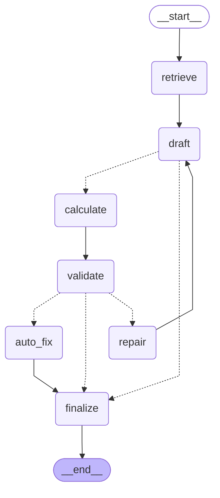

# Plan generation graph (Phase 4)

Generated from `app/planner.py` with `python -m app.planner`. Do not edit by hand.

| Node | What it does |
|---|---|
| retrieve | Searches the official scheme documents for this profile (RAG). Missing index -> warning, not a crash |
| draft | The LLM writes a PlanDraft with INPUT numbers only (plan_v1: free text, goes straight to finalize) |
| calculate | The calculator computes every total, profit, break-even and payback |
| validate | Plain Python rules: budget, reserve, price, break-even, real schemes, no promises, sections |
| repair | Sends the blocking issues back to the LLM as feedback (at most 2 rounds) |
| auto_fix | After the last round: drops invented schemes and softens promise words; budget/price problems stay visible |
| finalize | Builds the BusinessPlan, records timings and saves it in the session |
